<p align="center">
  
</p>

<h1 align="center">HeptaFloat</h1>

<p align="center">
  <b>Today's Heptabase journal, one keystroke away.</b><br>
  A small card that floats above your other windows — or waits in your MacBook's notch. Jot a thought, tick a to-do, and get back to work.
</p>

<p align="center">
  <a href="https://github.com/madeyexz/heptafloat/releases/latest"><b>⬇︎ Download for Mac</b></a>
  &nbsp;·&nbsp; macOS 13 or later &nbsp;·&nbsp; Apple Silicon & Intel &nbsp;·&nbsp; Free & open source
</p>

<table align="center">
  <tr>
    <td align="center" valign="top" width="50%">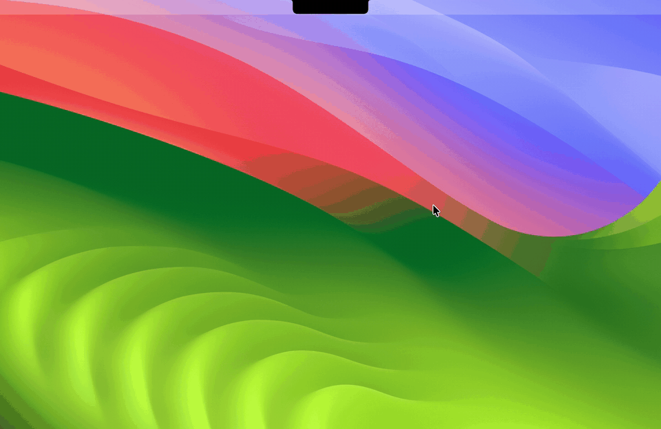<br><b>In the notch</b> — point at it, and the card drops down</td>
    <td align="center" valign="top" width="50%">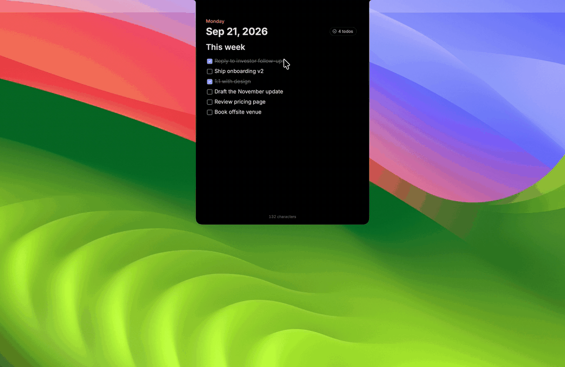<br><b>Or floating</b> — anywhere on screen, above every window</td>
  </tr>
</table>

<p align="center">
  <a href="docs/notch-demo.mp4"><b>▶ Watch the 30-second demo</b></a> &nbsp;·&nbsp; <a href="docs/demo-4x3.mp4">the 1-minute tour of the editor</a>
</p>

---

## Why

Opening Heptabase, finding today's journal, and switching back breaks your flow. HeptaFloat keeps today's journal in a little card you can pop up from anywhere — or tuck into the notch — like Raycast Notes, but it **is** your Heptabase journal. Everything you type is saved straight into Heptabase, and anything you add in Heptabase shows up in the card.

## What you get

| | |
|---|---|
| 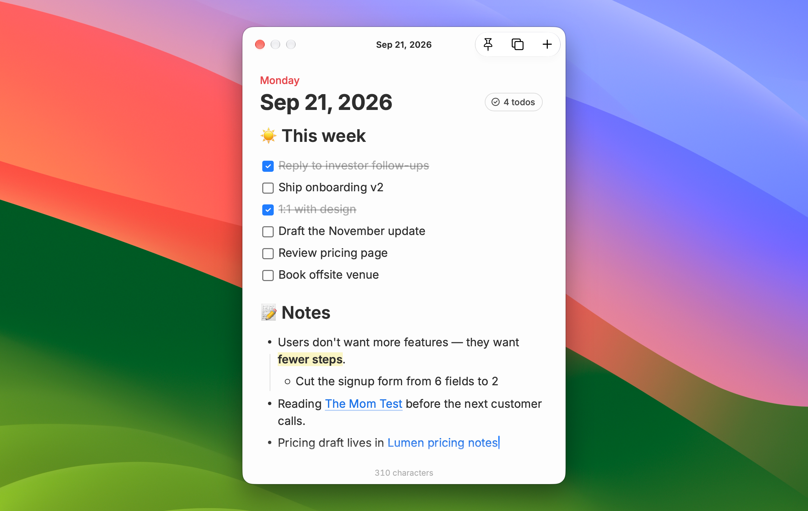 | 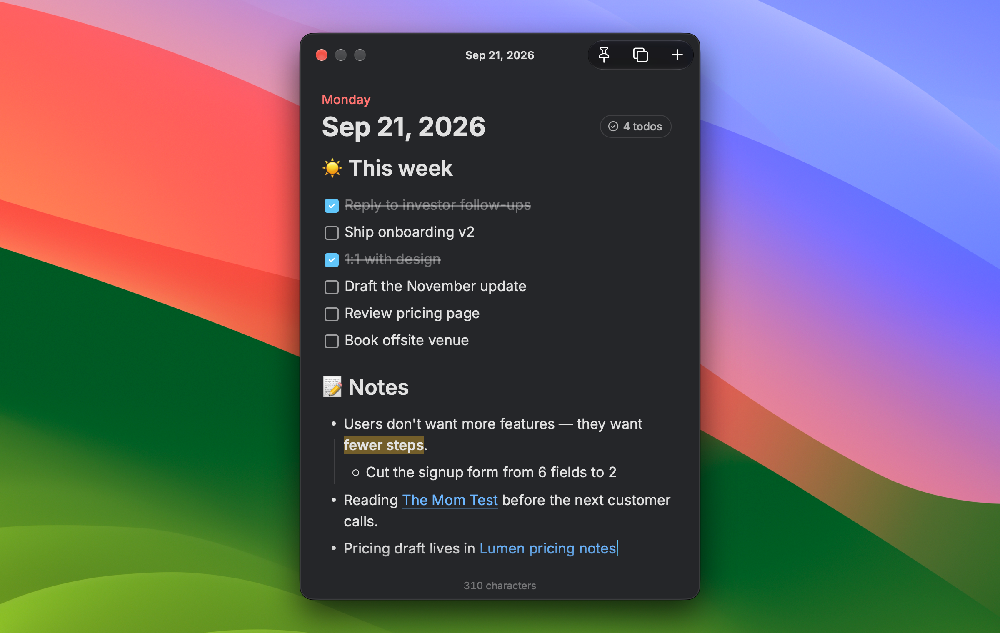 |
| **Floats above everything.** Put it anywhere on screen; it stays on top across desktops and full-screen apps. | **Looks like Heptabase.** Same font (Inter), colors, checkboxes, lists, link previews and highlights — in light and dark. |
| 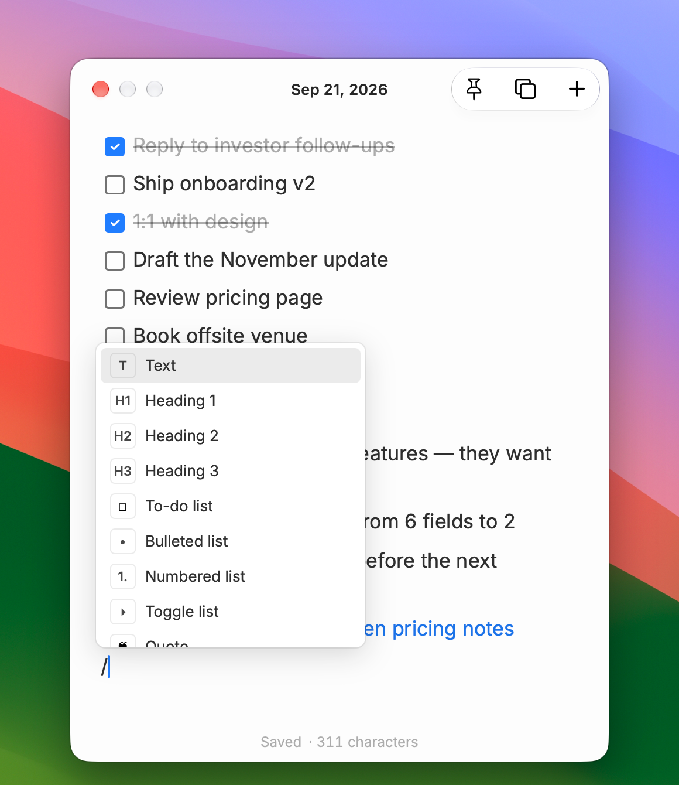 | 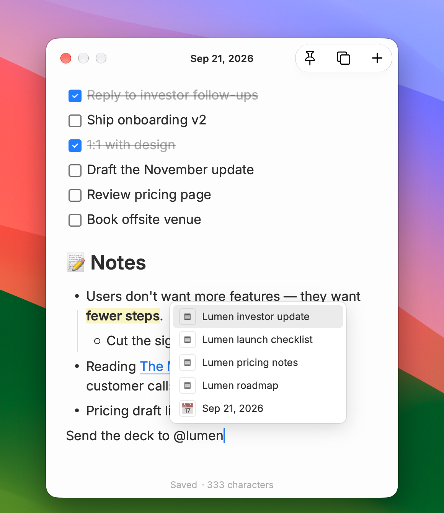 |
| **Type `/` for blocks** — to-dos, headings, bullets, toggles, quotes, dividers, today's date. | **Type `@` to mention a card** from your Heptabase library. Click a mention to open it here or in Heptabase. |
| 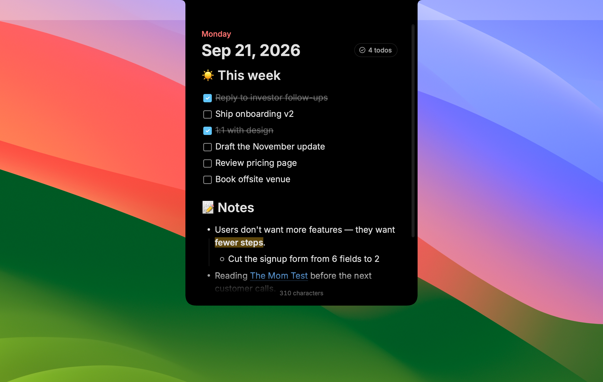 | 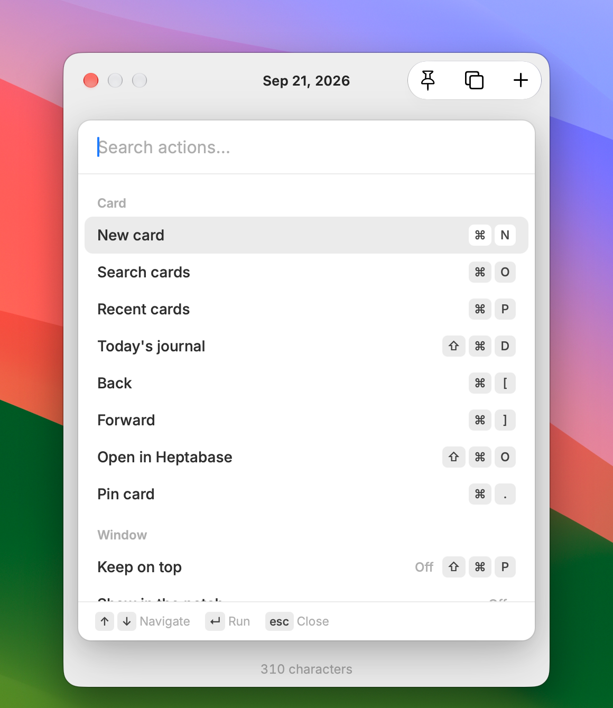 |
| **Or keep it in the notch.** Point at the notch and the card drops down; move away and it folds back. | **<kbd>⌘</kbd> <kbd>K</kbd> for every action** — cards, window and formatting, searchable, each with its shortcut. |

- **One shortcut to show and hide** — <kbd>⌃</kbd> <kbd>⌥</kbd> <kbd>J</kbd> by default; record any shortcut you like in Settings.
- **Jump to any card** — <kbd>⌘</kbd> <kbd>O</kbd> searches your Heptabase cards, <kbd>⌘</kbd> <kbd>P</kbd> shows the cards you've opened in HeptaFloat, <kbd>⌘</kbd> <kbd>[</kbd> / <kbd>⌘</kbd> <kbd>]</kbd> step through them, <kbd>⌘</kbd> <kbd>.</kbd> pins one, <kbd>⌘</kbd> <kbd>⇧</kbd> <kbd>D</kbd> goes back to today.
- **New card in a keystroke** — <kbd>⌘</kbd> <kbd>N</kbd> opens a blank card, like Raycast Notes. It's created in Heptabase as soon as you type (and not at all if you don't).
- **Lives in the notch, if you like** — turn on *Show the card in the notch* and the card waits in the MacBook notch. Point at it or press the shortcut and it drops down; move away or click elsewhere and it folds back. Drag its bottom edge or corners to resize it. It fits the notch at any display scaling.
- **A real Mac title bar** — the card's title in the middle and a glass button group for *Keep on top* (the pin, filled when on), recent cards and a new card (<kbd>+</kbd>). Drag the bar to move the card; the close button hides it, like <kbd>Esc</kbd>.
- **<kbd>⌘</kbd> <kbd>K</kbd> for everything** — one searchable list of every action for the card, the window and the text, each with its shortcut.
- **Paste a link onto text** — select some words and paste a URL; the words become a link.
- **Chinese, Japanese and other input methods** work as in any Mac app, in the floating card and in the notch.
- **Images** — pictures from Heptabase show up, and you can paste or drop images into the card.
- **Saves as you type** and stays in sync with Heptabase both ways — including cards you delete there.
- **Always today's page** — at midnight it moves to the new day's journal on its own.
- **Simple settings** — every shortcut, theme, text size, keep on top, notch mode, launch at login, and a check that Heptabase is connected.
- **Updates itself** — when a new version is out, the card's footer says so; click **Update** in Settings and HeptaFloat downloads it, checks it, and restarts into it.

## Install

1. **Download** `HeptaFloat-x.y.z.zip` from the [latest release](https://github.com/madeyexz/heptafloat/releases/latest) and double-click it to unzip.
2. **Drag `HeptaFloat`** into your **Applications** folder — `/Applications` or the one in your home folder (it needs to live there to update itself). If you open it from somewhere else, such as Downloads, HeptaFloat offers to move itself there.
3. **Open it.** Because HeptaFloat isn't from the App Store, macOS will warn you the first time:
   - Click **Done** (or **Cancel**) on the warning.
   - Open **System Settings → Privacy & Security**, scroll down, and click **Open Anyway** next to HeptaFloat.
   - Confirm with **Open**. You only need to do this once.

From 0.9.8 on, HeptaFloat updates itself (see **Settings → Version**). If you have 0.9.7 or older, download the latest release once by hand.

### One-time setup in Heptabase

HeptaFloat talks to Heptabase through Heptabase's built-in **CLI** ([Heptabase's guide](https://support.heptabase.com/en/articles/14715462-heptabase-cli)). You need:

1. The **Heptabase desktop app**, version 1.91 or later, **running**.
2. **Settings → AI Features → CLI** turned on in Heptabase.
3. An **active Heptabase subscription** (Heptabase only lets other apps in for subscribed accounts).

You don't have to remember this: until everything is in place, the card shows a checklist of exactly what's missing, with buttons to download or open Heptabase, and switches to today's journal by itself as soon as it can connect.

<p align="center"></p>

To double-check later, open **Settings** (<kbd>⌘</kbd> <kbd>,</kbd>) — the **Heptabase** section shows a green **Connected** when everything works.

## Jump between cards

| 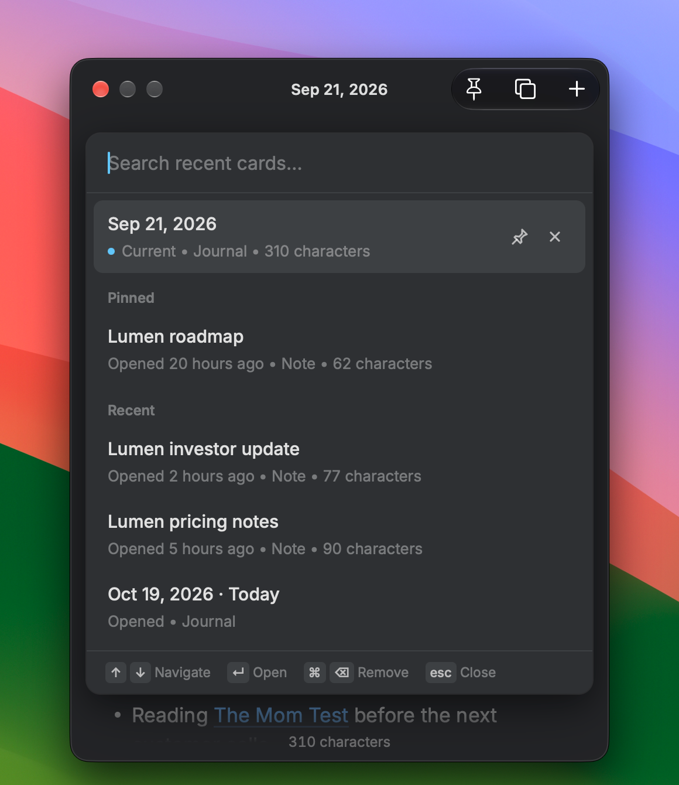 | 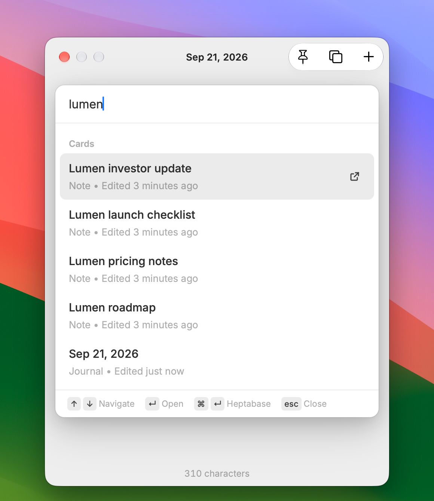 |
|---|---|
| **<kbd>⌘</kbd> <kbd>P</kbd> Recent cards** — the cards you've opened in HeptaFloat (its own list, kept on your Mac). Pin favorites to the top; × removes a card from the list (it never deletes anything in Heptabase). | **<kbd>⌘</kbd> <kbd>O</kbd> Search cards** — search everything in Heptabase. <kbd>↵</kbd> opens the card right here, <kbd>⌘</kbd> <kbd>↵</kbd> opens it in Heptabase. |

Notes and journals open in the floating card and are editable just like today's journal; other card types (PDFs, highlights…) open in Heptabase. <kbd>⌘</kbd> <kbd>⇧</kbd> <kbd>D</kbd> takes you back to today's journal.

**Links to other cards:** hover or click a card mention to choose **Open here** or **Open in Heptabase**. <kbd>⌘</kbd>-click goes straight to Heptabase.

## How to use it

| Do this | To |
|---|---|
| <kbd>⌃</kbd> <kbd>⌥</kbd> <kbd>J</kbd> | Show or hide the card from any app |
| <kbd>Esc</kbd> | Hide it (or fold it into the notch) and go back to what you were doing |
| Drag the title bar | Move the card; drag any edge to resize it (it remembers). In the notch: drag the bottom edge or a bottom corner |
| Point at the notch | Open the card in notch mode; move away or click elsewhere to fold it (unless *Keep on top* is on) |
| `/` | Insert a block: to-do, heading, list, toggle, quote, code, divider, date |
| `@` or `[[` | Mention a card |
| <kbd>⌘</kbd> <kbd>K</kbd> | The action menu: every command for the card, the window and the text in one list, each with its shortcut. Type to filter (`h1`, `todo`, `pin`…), <kbd>↵</kbd> runs it, <kbd>Esc</kbd> closes |
| Select text | Bold, italic, underline, strikethrough, code, link, **highlight & text color** |
| Paste a URL over selected text | Link the text to it (the text stays) |
| <kbd>⌘</kbd> <kbd>A</kbd> | Select the line you're in, like Heptabase; press again for the whole card |
| <kbd>⌘</kbd> <kbd>⇧</kbd> <kbd>H</kbd> | Highlight the selection in yellow (press again to remove) |
| <kbd>Tab</kbd> / <kbd>⇧</kbd> <kbd>Tab</kbd> | Indent / outdent list items — every selected one. On a plain line right below a bullet, <kbd>Tab</kbd> tucks it under that bullet |
| <kbd>⌫</kbd> at the start of a bullet | Turn it into plain text where it is; press again to join it with the line above |
| <kbd>⌘</kbd> <kbd>↩</kbd> | Tick or untick a to-do |
| <kbd>⌘</kbd> <kbd>N</kbd> | New card |
| <kbd>⌘</kbd> <kbd>.</kbd> | Pin / unpin the card to the top of Recent (⌘P) |
| <kbd>⌘</kbd> <kbd>[</kbd> / <kbd>⌘</kbd> <kbd>]</kbd> | Previous / next card in your Recent list (⌘P) |
| <kbd>⌘</kbd> <kbd>O</kbd> / <kbd>⌘</kbd> <kbd>P</kbd> | Search cards / recent cards |
| <kbd>⌘</kbd> <kbd>⇧</kbd> <kbd>D</kbd> | Today's journal |
| <kbd>⌘</kbd> <kbd>⇧</kbd> <kbd>O</kbd> | Open the current card in Heptabase |
| <kbd>⌘</kbd> <kbd>⇧</kbd> <kbd>P</kbd> | Keep on top on / off (the pin in the title bar) |
| <kbd>⌘</kbd> <kbd>=</kbd> / <kbd>⌘</kbd> <kbd>-</kbd> | Bigger / smaller text |

You can also type Markdown: `- ` bullets, `1. ` numbers, `[] ` to-dos, `# ` headings, `> ` quotes, `---` dividers.

### Settings

Press <kbd>⌘</kbd> <kbd>,</kbd> while the card is in front.

<p align="center">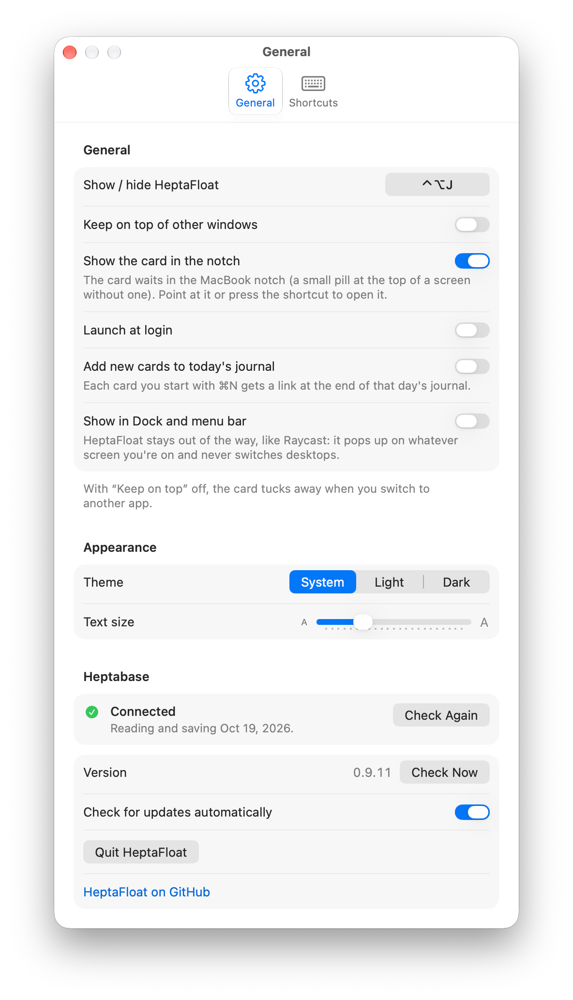</p>

**General**
- **Show / hide shortcut** — click it and press the keys you want. <kbd>Esc</kbd> cancels, **Reset** goes back to <kbd>⌃</kbd> <kbd>⌥</kbd> <kbd>J</kbd>.
- **Keep on top of other windows** — on: the card stays open when you click into another app. Off: it tucks away as soon as you do. Either way it floats above everything, full-screen apps included. The pin in the card's title bar (<kbd>⌘</kbd> <kbd>⇧</kbd> <kbd>P</kbd>) does the same. In the notch, it decides whether the open card stays put (on) or folds when you move away (off).
- **Show the card in the notch** — off by default (also in the <kbd>⌘</kbd> <kbd>K</kbd> menu). When on, the card waits in the MacBook notch (on a screen without one, a small pill at the top center). It's always dark there, to match the notch, and has no title bar — use the shortcuts or <kbd>⌘</kbd> <kbd>K</kbd>. Point at it or press the shortcut and it drops down into the full card; drag its bottom edge or a bottom corner to make it taller or wider (it stays centered under the notch, and keeps that size). With *Keep on top* on, it then stays until <kbd>Esc</kbd>, the shortcut or Close. With it off, a click outside the card folds it back at once, and so does moving the pointer away — but not while you're typing with an input method, a menu or popup from the card is open, or you're dragging.
- **Launch at login** — start HeptaFloat when you log in, so the shortcut always works.
- **Add new cards to today's journal** — off by default. When on, every card you start with <kbd>⌘</kbd> <kbd>N</kbd> is linked at the end of today's journal, so it's easy to find later.
- **Show in Dock and menu bar** — off by default, so HeptaFloat works like Raycast: no Dock icon, and the card pops up on whatever screen you're on without ever switching desktops. Turn it on for a Dock icon and the menus at the top of the screen (File, Format, View, Window, Help).
- **Theme** and **Text size**.
- **Heptabase** — shows whether HeptaFloat can reach your journal, with **Check Again** and **Open Heptabase**.
- **Version** — shows when a newer HeptaFloat is out, with **Update**: it downloads the new version from GitHub, makes sure it's exactly the file GitHub published (SHA-256) and a complete, signed HeptaFloat, swaps it in and restarts. If anything goes wrong, your current version stays as it was. **Check Now** checks right away.
- **Check for updates automatically** — on by default: HeptaFloat asks GitHub for the latest release when it starts and once a day.
- **Quit HeptaFloat** is at the bottom (or press <kbd>⌘</kbd> <kbd>Q</kbd> while the card is in front).

When a new version is out, the card's footer says so — click it to open Settings, then **Update**.

<p align="center">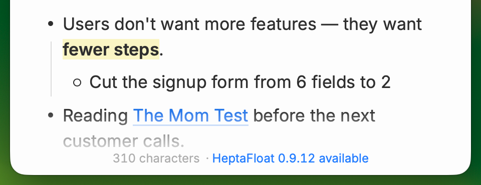</p>

**Shortcuts** — every keyboard shortcut in one place. Click one and press new keys to change it; HeptaFloat warns you if the keys are already taken. **Reset All Shortcuts** restores the defaults. *Link* has no keys by default (<kbd>⌘</kbd> <kbd>K</kbd> opens the action menu, which has *Add link*); give it some here if you like.

<p align="center">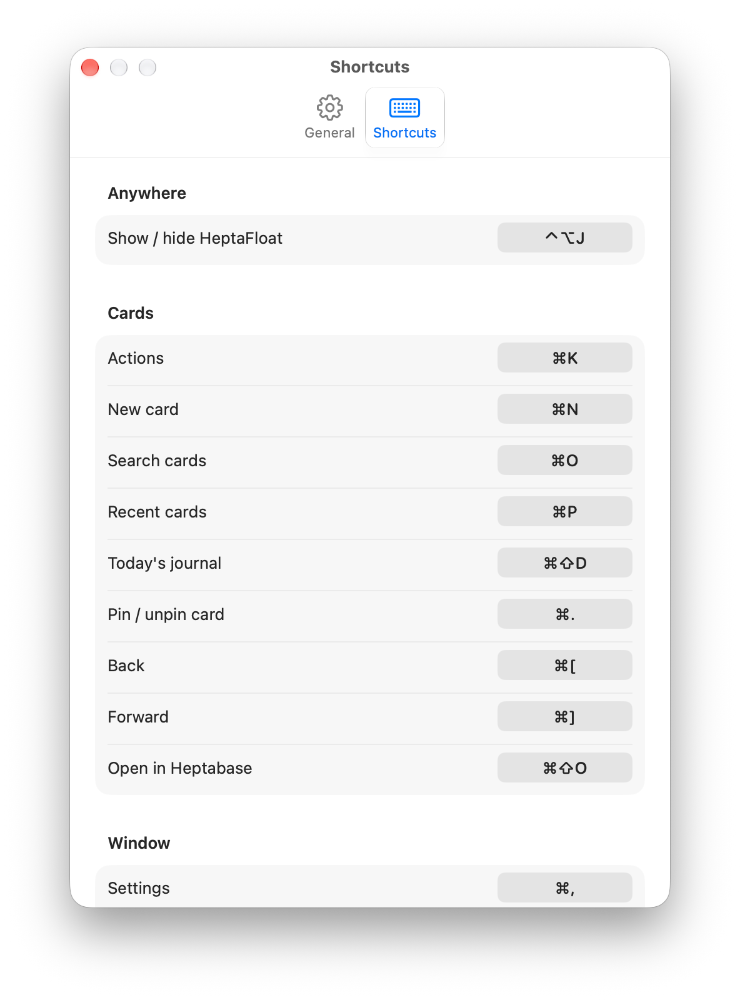</p>

> Using Raycast or another launcher? A launcher hotkey that opens HeptaFloat works too — press it again to hide. Just don't give the launcher and HeptaFloat's own shortcut the same keys.

## How it works

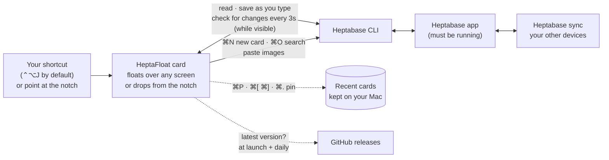

HeptaFloat never stores your notes, and the only thing it fetches from the internet itself is the latest release from GitHub (to offer updates). It reads and saves through the Heptabase app on your Mac (via Heptabase's CLI), and Heptabase syncs as usual. The only things HeptaFloat keeps are the ⌘P list of cards you've opened and a few cached images.

**What happens to what you type**

- **Saved about half a second after you stop typing.** Switching cards never waits: the card you leave keeps saving in the background, and anything you typed goes to the card you typed it in.
- **Heptabase closed or busy?** Your text stays in the card and is saved as soon as Heptabase answers again — the footer says *Not saved* until then.
- **Changed in Heptabase at the same time** (say, on your phone)? Nothing is overwritten: your version is kept as a new card, *“… — HeptaFloat copy”*, and the card shows Heptabase's.
- **Card deleted in Heptabase?** It leaves HeptaFloat's Recent list and closes if it's open; unsaved typing in it becomes a new card.
- **Checks for changes only while the card is on screen**, so it costs nothing in the background.

## Privacy

HeptaFloat runs entirely on your Mac. It reads and saves your journal through the Heptabase app on your computer and never sends your notes anywhere else. No accounts, no analytics. The only internet request HeptaFloat makes itself is asking GitHub for its latest release (at launch and once a day; turn off **Check for updates automatically** to stop it). It keeps a small log on your Mac for troubleshooting (card IDs and error messages, not your text) at `~/Library/Logs/HeptaFloat.log`.

## FAQ

**Does it work with notes other than the journal?** Yes — press <kbd>⌘</kbd> <kbd>O</kbd> to open any note or journal and edit it in the card. Other card types open in Heptabase.

**What if I delete a card in Heptabase?** It disappears from HeptaFloat's Recent list too, and if it's open in the card, it closes. Anything you'd typed into it that wasn't saved yet is kept as a new card.

**What if I edit the same card in Heptabase and HeptaFloat at once?** Nothing is lost — if both change at the same moment, your HeptaFloat version is saved as a separate *“HeptaFloat copy”* card (find it with <kbd>⌘</kbd> <kbd>P</kbd>).

**Something didn't sync. Where do I look?** The footer at the bottom of the card shows errors (hover for the full message), and **Help → Show Log File** (with *Show in Dock and menu bar* on) or `~/Library/Logs/HeptaFloat.log` has the details — include it when [reporting a problem](https://github.com/madeyexz/heptafloat/issues/new).

**Will it mess up my journal?** HeptaFloat keeps everything it doesn't edit exactly as it was (images, embeds, colors, tables…). Each save is checked against the latest version in Heptabase, so it won't overwrite changes you made there.

**How do I update?** From 0.9.8 on, the card's footer tells you when a new version is out; click it, then **Update** in Settings. If Update says it can't replace HeptaFloat, make sure the app is in your Applications folder and you opened it from there — or download the [latest release](https://github.com/madeyexz/heptafloat/releases/latest) and replace the app by hand.

**My Mac has no notch. Can I use notch mode?** Yes — on a screen without a notch, the card waits as a small pill at the top center of the screen and works the same way.

**Can I type Chinese or Japanese?** Yes. Input methods work in the floating card and in the notch, and HeptaFloat waits until you've picked a word before it saves, so half-typed Pinyin or kana never reaches Heptabase.

**Is this made by Heptabase?** No — it's an independent, unofficial companion app.

---

## For developers

HeptaFloat is a native Swift shell (non-activating floating `NSPanel` with a unified `NSToolbar`, a borderless notch panel sized from the screen's safe area, global hotkey, SwiftUI Settings) around a [ProseMirror](https://prosemirror.net) editor in a `WKWebView`. The editor is bundled as one IIFE, so minified names never leak into the page's globals (where they once clashed with `window.hf`, the bridge to Swift). It reads and writes cards with the Heptabase CLI (`heptabase journal|note read/save`, `note create`, `file import/export`, `card list/properties`), with md5 conflict checks. Saves are a queue of per-card snapshots, so switching cards never waits on a save.

```
Sources/main.swift   app shell: window, title bar, notch mode, hotkey, menus, Settings, CLI bridge, updater
src/schema.js        lossless ProseMirror schema for Heptabase's card format
src/editor.js        editor state, autosave, sync, day rollover
src/commands.js      list editing (indent, split, toggle…)
src/menus.js         "/" menu, @ mentions, selection toolbar, placeholders
src/palette.js       ⌘O search, ⌘P recent cards and the ⌘K action menu
src/setup.js         the setup checklist shown until Heptabase is reachable
src/index.html       styles (Heptabase theme tokens, light/dark)
preview/             run the editor in a browser with a demo journal
```

**Build:** `./build.sh` (needs [Bun](https://bun.sh) and Xcode Command Line Tools) — builds a Universal app, installs it to `~/Applications`, and writes `dist/HeptaFloat-<version>.zip`.

**Try the editor without Heptabase:** `./preview/serve.sh`, then open <http://localhost:8765/stage.html>.

**Regenerate screenshots and the demo:** `./preview/capture.sh` and `./preview/record-demo.sh` (need `agent-browser` and `ffmpeg`). They show the editor in a browser, so they don't include the native title bar or the notch; `docs/notch.gif` and `docs/notch-demo.mp4` are screen recordings of the real app on a MacBook. `open HeptaFloat.app --args --show-settings` opens Settings directly, for its screenshot; `--update-url <url>` checks another address instead of GitHub's latest release (for testing updates). On Linux, start the browser with `agent-browser --init-script preview/mac-platform.js open about:blank` first so the ⌘ shortcuts work; `FPS=24 ./preview/record-demo.sh` if the recording can't keep up.

**Release:** bump `VERSION` in `build.sh`, run `./build.sh`, then `gh release create vX.Y.Z dist/HeptaFloat-X.Y.Z.zip`. The updater relies on that shape: it reads the *latest* release (not drafts or pre-releases), takes the version from the `vX.Y.Z` tag, downloads the asset named exactly `HeptaFloat-X.Y.Z.zip`, checks it against the SHA-256 GitHub records on upload, and only installs a signed app whose `CFBundleShortVersionString` matches the tag.

**Round-trip test:** `bun test/roundtrip.js <folder of journal JSON>` checks that loading and saving a journal changes nothing.

## License

[MIT](LICENSE) © 2026 Ian Hsiao. Bundles the [Inter](https://rsms.me/inter/) typeface under the [SIL Open Font License](src/fonts/OFL.txt).
Heptabase is a trademark of its owners; this project is not affiliated with Heptabase.
